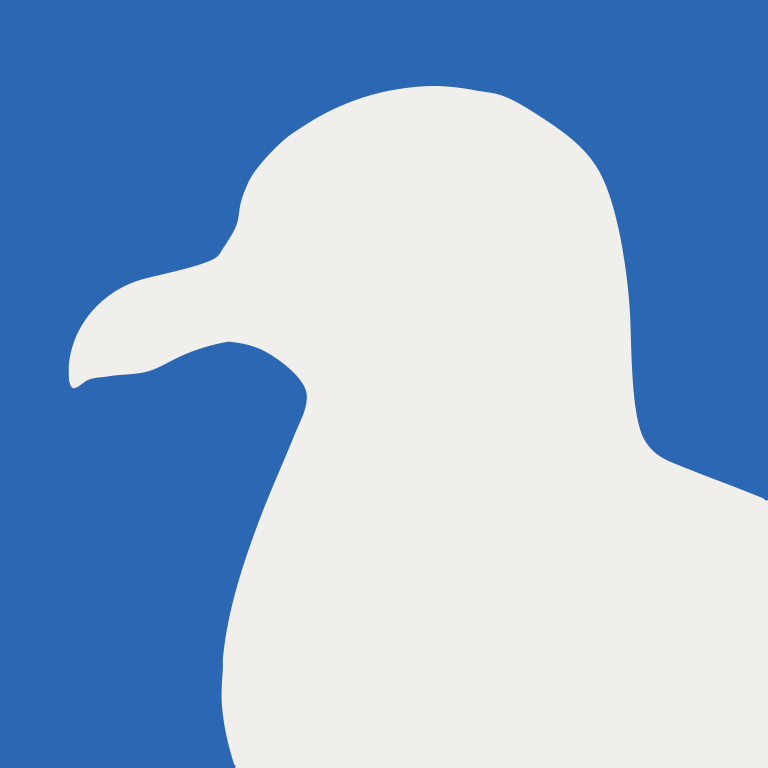

<p align="center">
  
</p>

<h1 align="center">noddock</h1>

<p align="center">
  <a href="README.md">English</a> | <a href="README.zh-CN.md">中文</a>
</p>

<p align="center">
  <a href="https://noddock.com"></a>
  <a href="https://github.com/noddock/noddock/releases"></a>
  <a href="https://github.com/noddock/noddock/issues"></a>
  <a href="https://www.youtube.com/@noddock-news"></a>
  <a href="LICENSE"></a>
</p>

## Introduction

**noddock** is a node-graph workflow automation tool: you build workflows by
connecting nodes, and combine workflows into projects. It provides local,
stable, secure and transparent automation services, with flexible extension
options — custom JS / Python nodes and custom node UIs — plus easy
export & load for sharing. You bring your own API keys to use the model nodes.

This repository is the **open-source part** of noddock, containing:

- all built-in **node implementations** (`nodes/`) — the complete node catalog
  and implementation methods used by the application;
- a simple **mock runtime** (`runtime/`) — compile and run a single node
  standalone;
- a **sample program** (`cmd/noddock`) — a full demo of single-node execution:
  load from the registry, set parameters, run, print the results.

The production engine (project/workflow management, front-end, accounts &
vault and other systems) is **not** included in this repo.

## Download

The noddock application is distributed via GitHub Releases:

👉 **[Download the latest release](https://github.com/noddock/noddock/releases)**

## Repository Layout

| Path               | What it is                                                                                                                                |
| ------------------ | ----------------------------------------------------------------------------------------------------------------------------------------- |
| `nodes/`           | Built-in node implementations (LLM, MCP, exec, db, json, logic, stream, audio, image, ui, core).                                          |
| `runtime/`         | Mock runtime: node spec/parameter/context/stream types, registry, and a single-node runner.                                               |
| `cmd/noddock/`     | Sample program: runs one node (Json--InlineJS demo) and prints the resulting context.                                                     |
| `example_project/` | The sample project shipped with the app, including the reference workflows mentioned in the tutorial.                                     |
| `assets/`          | Assets shipped with the app: usable JS scripts and the official custom HTML templates, accessible in nooddock directly via `/assets/...`. |

## Quick Start

```sh
# run the built-in demo (Json--InlineJS node)
go run ./cmd/noddock
```

`cmd/noddock` is a **sample program** that walks through the whole process:
pick a node, assign values, run it, read the results. Edit the main code and
rebuild to pick a different node or test a new one (see
`cmd/noddock/main.go`):

1. load a node from the registry: `manager.Registry["Json--InlineJS"]`;
2. build a `graph.Context` — first fill it with the spec's default values;
3. set your own input/edit values with `ctx.Set`;
4. run `node.Run(ctx, &runTool{node})` and read the results back from
   `ctx.Data`.

`cmd/noddock/node_run_tool.go` contains a mock `NodeRunTool` that provides the
methods of the surrounding systems, which are unrelated to the node itself.

## Bug Reports & Feature Requests

- To report a bug, please [open an issue](https://github.com/noddock/noddock/issues)
  or send an email to bug-report@noddock.com directly.
- Suggestions for fixes or new feature proposals can be submitted as issues.
- For other contact options, check the contact page on nooddock.com.

---

> The nooddock application is built with [Wails v3](https://wails.io) — a
> framework for building desktop apps with a web frontend and a Go backend.
